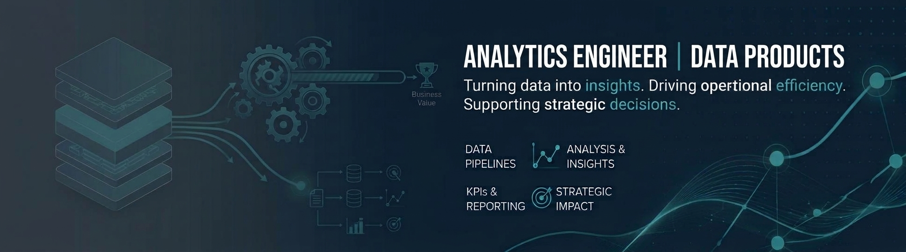
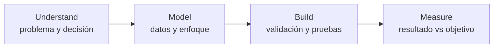

  

<h1 align="center">Juan de la Fuente</h1>

<strong>Analytics Engineer · Data &amp; AI Solutions</strong>

  Diseño soluciones de datos orientadas a decisiones: desde el problema de negocio hasta pipelines, APIs y productos analíticos con validación, calidad y trazabilidad.

  
  
  

---

## About

Antes de la ingeniería de datos, gestioné un negocio. Controlar inventario, costes, logística y márgenes me enseñó que los datos solo aportan valor cuando ayudan a tomar una decisión mejor. Ese criterio guía mi trabajo: entender el contexto, modelar con claridad e implementar soluciones verificables.

## Professional focus

| Área | Capacidades |
|---|---|
| **Analytics Engineering** | Modelado de datos, ETL/ELT, SQL y Python, calidad de datos, testing y validación |
| **Data & BI** | Exploración y análisis, dashboards, visualización, interpretación de resultados orientada a decisiones |
| **Engineering & AI** | APIs e integraciones, ingesta y automatización, gobernanza/validación, soluciones RAG e IA aplicada cuando el caso lo requiere |

## Technical toolkit

  
  
  
  
  
  
  
  
  
  
  

Herramientas representativas, respaldadas por experiencia y proyectos verificables.

---

## Featured projects

Selección curada de **6 capacidades** (presentación uniforme, legible en móvil): analytics/BI, APIs e integración, RAG, gobernanza HITL, ingesta/automatización y análisis geoespacial.

### 1) [NetTension](https://github.com/juandelaf1/NetTension) — Analytics, ETL & BI
Análisis trazable de dinámicas de tráfico e ingresos en telecom (CNMC/Eurostat) con pipeline ETL reproducible y dashboard interactivo en Streamlit. Evalúa hipótesis predefinidas con procedencia explícita de los datos.

**Demuestra:** ETL reproducible · análisis de datos · hipótesis/resultados trazables · BI interactivo  
**Stack:** Python · Pandas · ETL · Streamlit · Visualización  
**Evidencia visual:** [captura real del dashboard](https://raw.githubusercontent.com/juandelaf1/NetTension/main/assets/screenshots/01_market_overview.png) (recurso del repositorio).

### 2) [SkyCast](https://github.com/juandelaf1/SkyCast) — APIs & Data Integration
Servicios FastAPI de inteligencia climática para integración por contratos: `POST /api/v1/route-weather`, `POST /api/v1/validate-observation`, health/readiness y controles operativos configurables (m2m/scopes, rate limiting, auditoría, CORS y cabeceras de seguridad). Incluye módulos de ingesta/ETL y monitorización.

**Demuestra:** diseño de API · contratos y validación · integración de datos · operación/seguridad configurable  
**Stack:** FastAPI · Python · Pydantic · PostgreSQL/SQLAlchemy · Docker  
**Evidencia visual:** no se incluye captura en esta tarjeta; ver documentación técnica y recursos del [repositorio](https://github.com/juandelaf1/SkyCast).

### 3) [AsesorIA](https://github.com/juandelaf1/AsesorIA) — RAG & Grounded AI
Asistente conversacional con recuperación aumentada (RAG) orientado a respuestas fundamentadas, con trazabilidad documental (documento/página) y abstención cuando la evidencia es insuficiente. Incluye interfaz conversacional, recuperación vectorial, evaluación y configuración con contenedores/CI.

**Demuestra:** RAG y grounding · trazabilidad · control por evidencia · IA aplicada con rigor  
**Stack:** Python · LangChain · ChromaDB · Embeddings · Chainlit · Docker/CI  
**Evidencia visual:** no se incluye captura (sin recurso representativo verificado como evidencia canónica de UI).

### 4) [CASE](https://github.com/juandelaf1/CASE) — Decision Governance & HITL
Orquestación de decisiones que trata la salida del LLM como propuesta y aplica validación, comprobaciones de fiabilidad/riesgo y supervisión humana (human-in-the-loop). Proyecto de portfolio/investigación con limitaciones explícitas (no presentado como despliegue en producción).

**Demuestra:** HITL · validación estructurada · fiabilidad · gobernanza de decisiones asistidas  
**Stack:** Python · Pydantic · FastAPI · Patrones de fiabilidad  
**Evidencia visual:** [banner del repositorio](https://raw.githubusercontent.com/juandelaf1/CASE/main/docs/images/CASE_banner.jpg) (identidad visual, **no** captura de aplicación).

### 5) [RASPAL_SCRAPER](https://github.com/juandelaf1/RASPAL_SCRAPER) — Data Ingestion & Automation
Herramientas CLI y pipelines para obtener contenido web y extraer datos estructurados, con múltiples motores de scraping y flujos de IA local-first. Diseñado para mantener el procesamiento local por defecto.

**Demuestra:** ingesta web · extracción estructurada · automatización · procesamiento local  
**Stack:** Python · Web scraping · Playwright · Ollama · Docker/CI  
**Evidencia visual:** [banner del repositorio](https://raw.githubusercontent.com/juandelaf1/RASPAL_SCRAPER/main/assets/raspal_scrapper_banner.png) (identidad visual, **no** captura de aplicación).

### 6) [GeoRisk_Finder](https://github.com/juandelaf1/GeoRisk_Finder) — Geospatial Analytics & Risk *(collaborative)*
Plataforma de análisis geoespacial de riesgo multiamenaza con malla H3, integración de fuentes (p. ej., sísmicas, ciclones, volcánicas) y clustering, con dashboard interactivo en Streamlit. **Proyecto colaborativo** (origen académico/data science). Las salidas financieras/BCR, cuando se presentan, se formulan como **modelos o escenarios de análisis**, no como resultados financieros reales ni funcionalidades productivas demostradas.

**Demuestra:** analítica geoespacial · integración multiamenaza · clustering · visualización interactiva  
**Stack:** Python · H3/Geoespacial · scikit-learn · Streamlit · Visualización  
**Evidencia visual:** no se incluye captura en esta tarjeta (sin recurso representativo verificado).

---

## Approach

## Contact

- Portfolio: [juandelaf1.github.io](https://juandelaf1.github.io)
- LinkedIn: [linkedin.com/in/juandelafuentelarrocca](https://linkedin.com/in/juandelafuentelarrocca)
- GitHub: [@juandelaf1](https://github.com/juandelaf1)

Perfiles y enlaces verificados al momento de esta propuesta.
