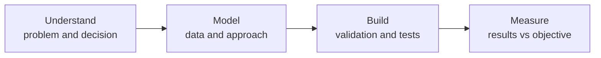

🌐 **EN** | [ES](README.es.md)

  

<h1 align="center">Juan de la Fuente</h1>

<strong>Analytics Engineer · Data &amp; AI Solutions</strong>

  I design data solutions that support better decisions: from business context to pipelines, APIs, and analytical products with validation, quality, and traceability.

  
  
  

---

## About

Before working in data engineering, I ran a business. Managing inventory, costs, logistics, and margins taught me that data only creates value when it helps someone make a better decision. That perspective shapes my work: understand the context, model with clarity, and build solutions that can be verified.

## Professional focus

| Area | Capabilities |
|---|---|
| **Analytics Engineering** | Data modeling, ETL/ELT, SQL and Python, data quality, testing and validation |
| **Data & BI** | Data exploration and analysis, dashboards, visualization, decision-oriented interpretation |
| **Engineering & AI** | APIs and integrations, ingestion and automation, governance/validation, RAG and applied AI solutions when appropriate |

## Technical toolkit

  
  
  
  
  
  
  
  
  
  
  

Representative tools, supported by verifiable experience and projects.

---

## Featured projects

A curated selection of **6 capabilities** (uniform, mobile-friendly layout): analytics/BI, APIs and integration, RAG, HITL decision governance, ingestion/automation, and geospatial analysis.

### 1) [NetTension](https://github.com/juandelaf1/NetTension) — Analytics, ETL & BI
Traceable analysis of traffic and revenue dynamics in telecom (CNMC/Eurostat), with a reproducible ETL pipeline and an interactive Streamlit dashboard. Evaluates predefined hypotheses with explicit data provenance.

**Demonstrates:** reproducible ETL · data analysis · traceable hypotheses/results · interactive BI  
**Stack:** Python · Pandas · ETL · Streamlit · Visualization  
**Visual evidence:** [real dashboard screenshot](https://raw.githubusercontent.com/juandelaf1/NetTension/main/assets/screenshots/01_market_overview.png) (repository resource).

### 2) [SkyCast](https://github.com/juandelaf1/SkyCast) — APIs & Data Integration
FastAPI services for climate-data integration through contracts: `POST /api/v1/route-weather`, `POST /api/v1/validate-observation`, health/readiness, and configurable operational controls (m2m/scopes, rate limiting, audit, CORS, and security headers). Includes ingestion/ETL and monitoring modules.

**Demonstrates:** API design · contracts and validation · data integration · configurable operations/security  
**Stack:** FastAPI · Python · Pydantic · PostgreSQL/SQLAlchemy · Docker  
**Visual evidence:** no screenshot included in this card; see technical documentation and resources in the [repository](https://github.com/juandelaf1/SkyCast).

### 3) [AsesorIA](https://github.com/juandelaf1/AsesorIA) — RAG & Grounded AI
A conversational retrieval-augmented (RAG) assistant focused on grounded answers, with document/page traceability and abstention when evidence is insufficient. Includes a conversational interface, vector retrieval, evaluation, and a containerized/CI development setup.

**Demonstrates:** RAG and grounding · traceability · evidence-based control · rigorous applied AI  
**Stack:** Python · LangChain · ChromaDB · Embeddings · Chainlit · Docker/CI  
**Visual evidence:** no screenshot included (no verified representative resource used as canonical UI evidence).

### 4) [CASE](https://github.com/juandelaf1/CASE) — Decision Governance & HITL
Decision orchestration that treats LLM output as a proposal and applies validation, reliability/risk checks, and human-in-the-loop oversight. A portfolio/research project with explicit limitations (not presented as a production deployment).

**Demonstrates:** HITL · structured validation · reliability · assisted decision governance  
**Stack:** Python · Pydantic · FastAPI · Reliability patterns  
**Visual evidence:** [repository banner](https://raw.githubusercontent.com/juandelaf1/CASE/main/docs/images/CASE_banner.jpg) (visual identity, **not** an application screenshot).

### 5) [RASPAL_SCRAPER](https://github.com/juandelaf1/RASPAL_SCRAPER) — Data Ingestion & Automation
CLI tools and pipelines to fetch web content and extract structured data, with multiple scraping engines and local-first AI workflows. Designed to keep processing local by default.

**Demonstrates:** web ingestion · structured extraction · automation · local processing  
**Stack:** Python · Web scraping · Playwright · Ollama · Docker/CI  
**Visual evidence:** [repository banner](https://raw.githubusercontent.com/juandelaf1/RASPAL_SCRAPER/main/assets/raspal_scrapper_banner.png) (visual identity, **not** an application screenshot).

### 6) [GeoRisk_Finder](https://github.com/juandelaf1/GeoRisk_Finder) — Geospatial Analytics & Risk *(collaborative)*
A geospatial multi-hazard risk analysis platform using an H3 grid, multi-source data integration (e.g., seismic, cyclone, volcanic), clustering, and an interactive Streamlit dashboard. **Collaborative project** (academic/data science origin). Financial/BCR outputs, when presented, are framed as **analysis models or scenarios**, not real financial results or demonstrated production capabilities.

**Demonstrates:** geospatial analytics · multi-hazard data integration · clustering · interactive visualization  
**Stack:** Python · H3/Geospatial · scikit-learn · Streamlit · Visualization  
**Visual evidence:** no screenshot included in this card (no verified representative resource).

---

## Approach

## Contact

- Portfolio: [juandelaf1.github.io](https://juandelaf1.github.io)
- LinkedIn: [linkedin.com/in/juandelafuentelarrocca](https://linkedin.com/in/juandelafuentelarrocca)
- GitHub: [@juandelaf1](https://github.com/juandelaf1)

Profiles and links verified at the time of this proposal.
